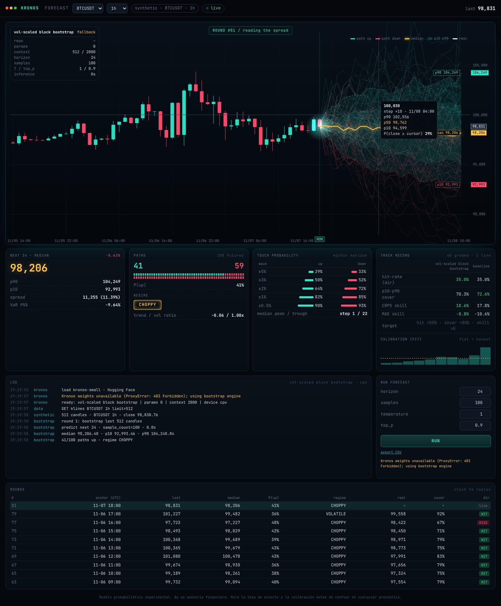

# Kronos Lab: predictor de velas con IA, evaluado en vivo

Panel que pronostica las próximas velas de un criptoactivo con **[Kronos](https://github.com/shiyu-coder/Kronos)**, un modelo fundacional de código abierto (MIT, AAAI 2026) preentrenado con más de 12.000 millones de velas de más de 45 exchanges. En lugar de dar una sola línea, genera **100 futuros posibles** y después **comprueba en vivo** si acertó.



## Qué replica del panel viral
- Abanico de 100 trayectorias Monte Carlo (sube/baja), mediana, banda p10–p90.
- Mediana a 24 velas, p90/p10/spread, conteo de rutas al alza y a la baja.
- Hit-rate, régimen (CHOPPY, etc.) y log tipo terminal en vivo.
- Rondas automáticas: cada vez que cierra una vela se lanza un nuevo pronóstico.

## Qué mejora
| Mejora | Por qué importa |
|---|---|
| **Benchmark contra un modelo base** (bootstrap por bloques escalado por volatilidad), ejecutado en la sombra en cada ronda | Un hit-rate solo, sin comparar, no dice nada. Aquí se ve si Kronos supera de verdad a una alternativa estadística |
| **Calibración**: cobertura p10–p90 (lo ideal es ~80 %) e histograma PIT | Indica si la incertidumbre que muestra el modelo es honesta |
| **CRPS skill y MAE skill** frente a "el precio no cambia" | Métricas de puntuación adecuadas para pronósticos probabilísticos, no solo de dirección |
| **Probabilidad de tocar niveles** (±0,5 a ±5 %), VaR/CVaR 95 % | Información útil para fijar stops y objetivos |
| **Tooltip probabilístico**: P(cierre ≥ precio del cursor) en cada paso futuro | Permite leer la distribución en cualquier punto del gráfico |
| **Historial persistente** (SQLite), repetición de rondas pasadas y exportación CSV | El registro de resultados sobrevive a reinicios |
| **Backtest walk-forward** por CLI | Mide el modelo con meses de historia antes de confiar en él |
| Varios símbolos e intervalos (1m–1d), modelos mini/small/base, temperatura y top_p | Permite explorar distintas configuraciones |
| Fuentes de datos con respaldo: Binance → Bybit → OKX → sintético | Sigue funcionando aunque una API esté bloqueada en tu país |
| Respaldo automático si no se pueden descargar los pesos, y modo totalmente offline | El panel nunca queda roto |

Detalle técnico: `KronosPredictor.predict(sample_count=N)` **promedia** las N muestras en una sola línea. Aquí se conserva cada trayectoria (lote de N filas con `sample_count=1`), que es lo que hace posibles el abanico, los cuantiles y la calibración.

## Uso
```bash
pip install -r requirements.txt
uvicorn app.server:app --port 8000      # abre http://localhost:8000
```
La primera vez descarga Kronos-small (~100 MB) desde Hugging Face. En CPU, 100 trayectorias × 24 velas tardan del orden de segundos a un minuto. Si tienes GPU (CUDA o Apple MPS), se usa automáticamente.

Backtest (¿le gana Kronos al modelo base?):
```bash
python -m app.backtest --symbol BTCUSDT --interval 1h --rounds 60 --step 12 --samples 30
```

Pesos offline:
```bash
python scripts/download_weights.py kronos-small ./weights
KRONOS_WEIGHTS_DIR=./weights/kronos-small uvicorn app.server:app
```

En una Mac encendida 24/7 (servicio en segundo plano, se reinicia solo):
```bash
git clone -b claude/lucid-rubin-ltu6sf https://github.com/luis17871/CryptoLernex.git ~/CryptoLernex
bash ~/CryptoLernex/scripts/mac/setup.sh        # abre http://localhost:8000
```

Docker: `docker build -t kronos-lab . && docker run -p 8000:8000 kronos-lab`

### Configuración (variables de entorno)
| Variable | Por defecto | |
|---|---|---|
| `KRONOS_MODEL` | `kronos-small` | `kronos-mini` (contexto 2048), `kronos-small`, `kronos-base` |
| `KRONOS_ENGINE` | `auto` | `kronos`, `bootstrap`, o `auto` (Kronos y, si falla, bootstrap) |
| `KRONOS_SOURCE` | `auto` | `binance`, `bybit`, `okx`, `synthetic` |
| `KRONOS_SYMBOL` / `KRONOS_SYMBOLS` | `BTCUSDT` / `BTCUSDT,ETHUSDT,SOLUSDT` | |
| `KRONOS_INTERVAL` | `1h` | 1m 5m 15m 30m 1h 4h 1d |
| `KRONOS_HORIZON` / `KRONOS_SAMPLES` | `24` / `100` | |
| `KRONOS_LOOKBACK` | `512` | se recorta al contexto máximo del modelo |
| `KRONOS_TEMPERATURE` / `KRONOS_TOP_P` | `1.0` / `0.9` | |
| `KRONOS_AUTO_RUN` / `KRONOS_POLL_SECONDS` | `1` / `30` | |
| `KRONOS_DEVICE` | auto | `cpu`, `cuda:0`, `mps` |

## Cómo leer las métricas
- **Hit-rate > 50 %**: el modelo acierta la dirección más que una moneda al aire. Con pocas rondas es solo ruido; necesitas más de 100.
- **Cobertura ≈ 80 %**: la banda p10–p90 es honesta. Si es mucho menor, el modelo está sobreconfiado.
- **PIT plano**: buena calibración. Forma de U indica sobreconfianza; joroba central, exceso de cautela; inclinado, sesgo.
- **CRPS skill > 0**: la distribución completa supera a "no cambia nada".

## Estructura
```
app/
  data.py       velas cerradas (Binance/Bybit/OKX/sintético)
  engine.py     KronosEngine (trayectorias individuales) + BootstrapEngine (modelo base)
  analytics.py  cuantiles, régimen, prob. de toque, CRPS, cobertura, PIT
  service.py    rondas, evaluación en vivo, log de eventos
  server.py     API FastAPI + SSE
  backtest.py   evaluación walk-forward
  vendor/kronos código del modelo Kronos (MIT)
web/            panel (canvas, sin dependencias)
tests/          pytest
```

## Aviso
Herramienta experimental de investigación. **No es asesoría financiera.** Los propios autores de Kronos advierten que sus señales no son alfa pura. Decide con base en el registro de resultados en vivo y el backtest, no en un solo gráfico bonito.
